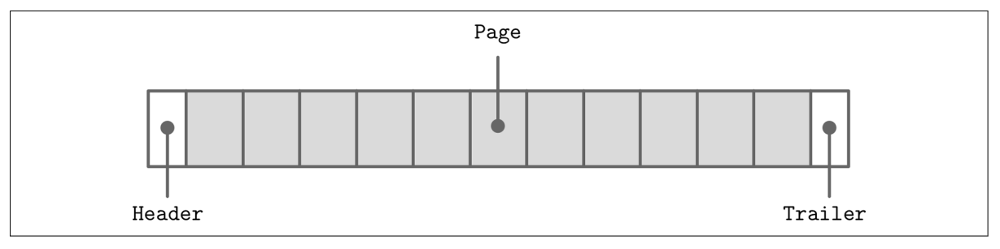
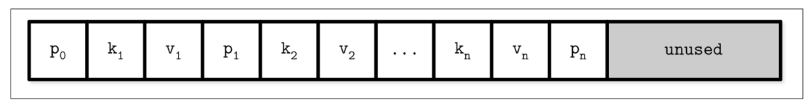
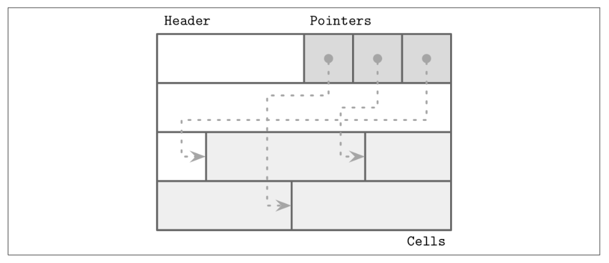
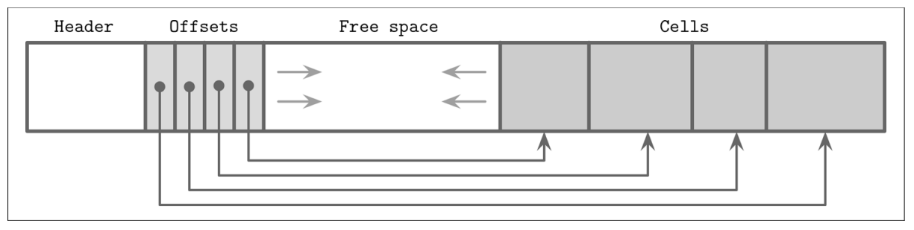
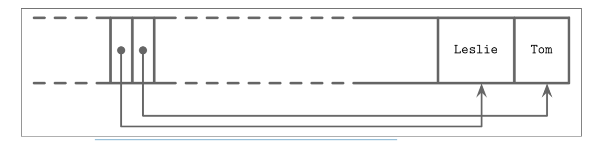
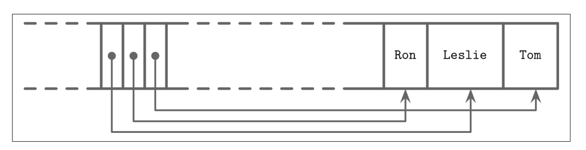
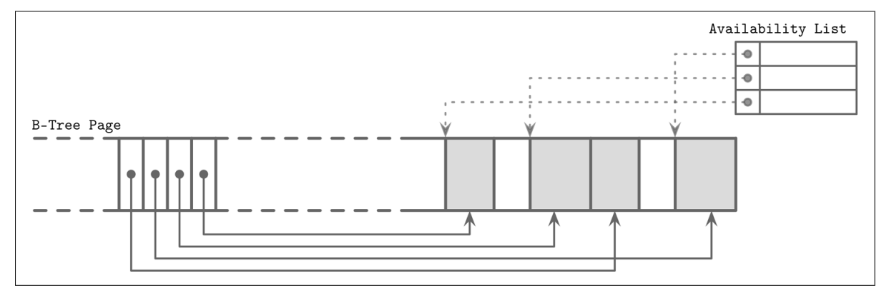

# File-Formats

### General Principles

Usually, you start designing a file format by deciding how the addressing is going to
be done: whether the file is going to be split into same-sized pages, which are repre‐
sented by a single block or multiple contiguous blocks. Most in-place update storage
structures use pages of the same size, since it significantly simplifies read and write
access. Append-only storage structures often write data page-wise, too: records are
appended one after the other and, as soon as the page fills up in memory, it is flushed
on disk.


The file usually starts with a fixed-size header and may end with a fixed-size trailer,
which hold auxiliary information that should be accessed quickly or is required for
decoding the rest of the file. The rest of the file is split into pages. Figure 3-3 shows
this file organization schematically.




for data stores that has fixed schema, that can help to reduce the amount of data stored on disk.

If we wanted to design a format for the company directory, storing names, birth
dates, tax numbers, and genders for each employee, we could use several approaches.
We could store the fixed-size fields (such as birth date and tax number) in the head of
the structure, followed by the variable-size ones:
```
Fixed-size fields:

| (4 bytes) employee_id |
| (4 bytes) tax_number |
| (3 bytes) date |
| (1 byte) gender |
| (2 bytes) first_name_length |
| (2 bytes) last_name_length |
Variable-size fields:
| (first_name_length bytes) first_name |
| (last_name_length bytes) last_name |
```

To avoid calculations involving multiple fields,
we can encode both offset and length to the fixed-size area. In this case, we can locate
any variable-size field separately.


### Page Structure

Database systems store data records in data and index files. These files are partitioned
into fixed-size units called pages, which often have a size of multiple filesystem blocks. Page sizes usually range from 4 to 16 Kb.

The original B-Tree paper describes a simple page organization for fixedsize data records, where each page is just a concatenation of triplets, as shown in, keys are denoted by k, associated values are denoted by v, and pointers to
child pages are denoted by p.



### Slotted Pages

slotted pages help us with the variable size records, it provides and allow us to do:
 - Store variable-size records with a minimal overhead.
 - Reclaim space occupied by the removed records.
 - Reference records in the page without regard to their exact locations

We organize the page into a collection of slots or cells and split out pointers and cells
in two independent memory regions residing on different sides of the page. This
means that we only need to reorganize pointers addressing the cells to preserve the
order, and deleting a record can be done either by nullifying its pointer or removing
it


by having slotted pages now we can fix our problems:
- Minimal overhead: the only overhead incurred by slotted pages is a pointer array
holding offsets to the exact positions where the records are stored.
- Space reclamation: space can be reclaimed by defragmenting and rewriting the
page.
- Dynamic layout: from outside the page, slots are referenced only by their IDs, so
the exact location is internal to the page.


### cell layout
cell types are either key or key-value cells. depends on the type of the node we use the apropriate cell type, for internal nodes we use key cells, for leaf nodes we use key-value cells. cell types has to be uniform, a page can't have a mix of fixed size or variable size cells. the meta data of the cells are stored on the page level.

a variable-size key cell compose of:

- Cell type (metadata)
- Key size
- Id of child page
- Key bytes

```
0                4               8
+----------------+---------------+-------------+
| [int] key_size | [int] page_id | [bytes] key |
+----------------+---------------+-------------+
```

if we were t omake it a fixed size, we won't need the key-size 4 bytes, we would simply already know how much of data the cell would occupy.


for a key-value cell, it compose of:

- Cell type (metadata)
- Key size
- Value size
- Key-bytes
- Data record bytes
```
0              1                5 ...
+--------------+----------------+
| [byte] flags | [int] key_size |
+--------------+----------------+
5                  9                 .. + key_size
+------------------+--------------------+----------------------+
| [int] value_size | [bytes] key        | [bytes] data_record |
+------------------+--------------------+----------------------+
```

same thing, for a fixed-size cell we would remove the key_size.

> remember the index-organized data files, primary key and secondry key in chapter 1

> Note: cell offests are page-local and are relative to the page start offest, while page id is the identifier to the page itself which appears in key cell types.

> Note: if a record larger than the page size, we do what is called TOAST, which is we store the record across different pages of overflow type and have a pointer to it at the main page that points to it.


### Combining Cells into Slotted Pages

To organize cells into pages, we can use the slotted page technique that we discussed.We append cells to the right side of the page (toward its end) and keep cell offsets/pointers in the left side of the page, as shown.



Keys can be inserted out of order and their logical sorted order is kept by sorting cell
offset pointers in key order. This design allows appending cells to the page with mini‐
mal effort, since cells don’t have to be relocated during insert, update, or delete
operations.


Let’s consider an example of a page that holds names. Two names are added to the
page, and their insertion order is: Tom and Leslie. their logical order (in this case, alphabetical), does not match insertion order (order in which they were appended to the page). Cells are laid out in insertion order, but off‐sets are re-sorted to allow using binary search.

Now, we’d like to add one more name to this page: Ron. New data is appended at the
upper boundary of the free space of the page, but cell offsets have to preserve the lexi‐
cographical key order: Leslie, Ron, Tom. To do that, we have to reorder cell offsets:
pointers after the insertion point are shifted to the right to make space for the new
pointer to the Ron cell, as you can see


> Note: sorting the offsets happen based on the key-value of the record.


### Managing Variable-Size Data

Removing an item from the page does not have to remove the actual cell and shift
other cells to reoccupy the freed space. Instead, the cell can be marked as deleted and
an in-memory availability list can be updated with the amount of freed memory and
a pointer to the freed value. The availability list stores offsets of freed segments and
their sizes. When inserting a new cell, we first check the availability list to find if
there’s a segment where it may fit


> Note: SQLite calls unoccupied segments freeblocks and stores a pointer to the first freeblock in the page header. Additionally, it stores a total number of available bytes within the page to quickly check whether or not we can fit a new element into the page after defragmenting it.

choosing the right place to insert a new record is done using either best fit or first fit, if we can't find enough consecutive bytes but the total fragmented bytes are enough, we defragmant the page and reclame space for new write (aka we read and write the page back). this is called defragmentation. if there is no enough space after defragmentation we do an overflow page.

In summary, to simplify B-Tree layout, we assume that each node occupies a single
page. A page consists of a fixed-size header, cell pointer block, and cells. Cells hold
keys and pointers to the pages representing child nodes or associated data records. BTrees use simple pointer hierarchies: page identifiers to locate the child nodes in the
tree file, and cell offsets to locate cells within the page.

