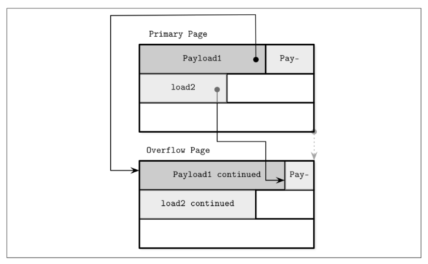
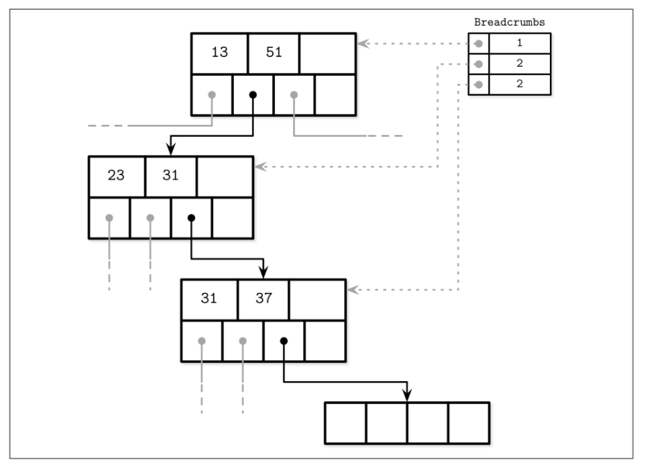

# Implementing_B-Tree

### page header
contains useful metadata that can be used for navigation, maintenance and optimization. for example => flags for page content and layout, number of cells lower and upper offsets.

some databases including posgtes stores page size and layout version in the header.

### magic numbers
One of the values often placed in the file or page header is a magic number. Usually,
it’s a multibyte block, containing a constant value that can be used to signal that the
block represents a page, specify its kind, or identify its version.

it is hard coded and placed in the page header on write, when reading we compare it to the expected hard coded value to make sure we are reading correctly and we don't miss position some offsets later.

### right most pointer
B-trees has N keys and N+1 child page id, as dissucsed in the previous chapter, internal nodes have a cell of type key-cell, each key has a child page id. that would leave a 1 child page id missing. this id (aka pointer) would usually be stored in the page header as Sqlite do. 

### Node High Keys
We can take a slightly different approach and store the rightmost pointer in the cell
along with the node high key. The high key represents the highest possible key that
can be present in the subtree under the current node. This approach is used by Post‐
greSQL and is called B
link-Trees

### overflow pages
To implement variable-size nodes without copying data to the new contiguous region,
we can build nodes from multiple linked pages. For example, the default page size is 4
K, and after inserting a few values, its data size has grown over 4 K. Instead of allow‐
ing arbitrary sizes, nodes are allowed to grow in 4 K increments, so we allocate a 4 K
extension page and link it from the original one. These linked page extensions are
called overflow pages. For clarity, we call the original page the primary page in the
scope of this section.

Overflow pages require some extra bookkeeping, since they may get fragmented as
well as primary pages, and we have to be able to reclaim this space to write new data,
or discard the overflow page if it’s not needed anymore.

When the first overflow page is allocated, its page ID is stored in the header of the
primary page. If a single overflow page is not enough, multiple overflow pages are
linked together by storing the next overflow page ID in the previous one’s header.
Several pages may have to be traversed to locate the overflow part for the given
payload.

Since keys usually have high cardinality, storing a portion of a key makes sense, as
most of the comparisons can be made on the trimmed key part that resides in the
primary page.

### Breadcrumbs
Instead of storing and maintaining parent node pointers, it is possible to keep track of
nodes traversed on the path to the target leaf node, and follow the chain of parent
nodes in reverse order in case of cascading splits during inserts, or merges during
deletes.

During operations that may result in structural changes of the B-Tree (insert or
delete), we first traverse the tree from the root to the leaf to find the target node and
the insertion point. Since we do not always know up front whether or not the opera‐
tion will result in a split or merge (at least not until the target leaf node is located), we have to collect breadcrumbs.

Breadcrumbs contain references to the nodes followed from the root and are used to
backtrack them in reverse when propagating splits or merges. The most natural data
structure for this is a stack. For example, PostgreSQL stores breadcrumbs in a stack,
internally referenced as BTStack

If the node is split or merged, breadcrumbs can be used to find insertion points for
the keys pulled to the parent and to walk back up the tree to propagate structural
changes to the higher-level nodes, if necessary. This stack is maintained in memory.

