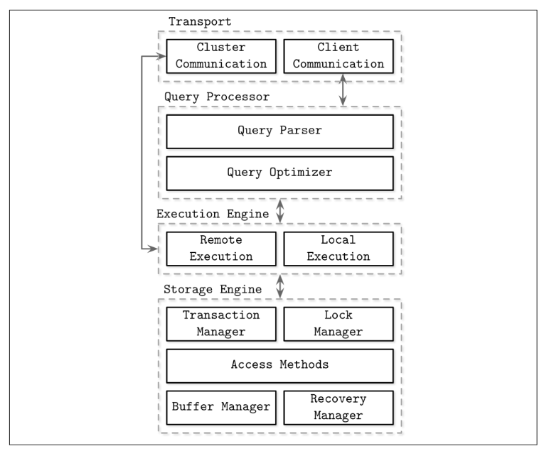
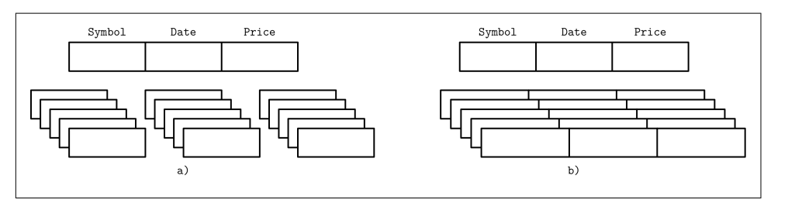
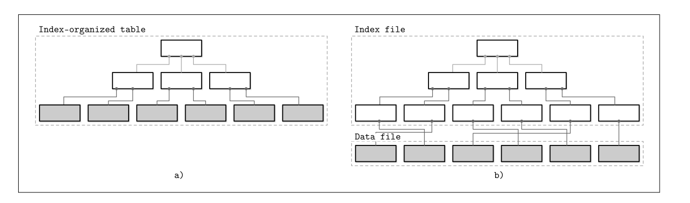

# Intro-components&comparison

## Database categoriezing

- 1- OLTP databases => handle large number of user requests and queries, often queries are pre-defined
- 2- OLAP databases => handle complex queries fast and used for analytics and data warehousing
- 3- HTAP databases => both OLAP + OLTP

<mark class="hl-orange">There are many other terms and classifications: key-value stores, relational databases,
document-oriented stores, and graph databases</mark>

Database management systems use a client/server model, where database system
instances (nodes) take the role of servers, and application instances take the role of
clients.
Client requests arrive through the transport subsystem. Requests come in the form of
queries, most often expressed in some query language. The transport subsystem is
also responsible for communication with other nodes in the database cluster

### common arch of dbs 

### Steps
- 1 Query Ppareser => checks the user query request and interpret it
- 2 Query Optimizer => creates what is called a query plan, picks the best one by eliminating redundant parts of the query and attepmting to find the most efficent way to execute it based on internal statistics 
- 3 Execution Engine => handels execution plan which end up collecting the data from the storage engine from local and remote nodes,Remote execution can involve writing and reading data to and from other nodes in the cluster, and replication.
- 4 Storage Engine => has several components:
    - Transaction Manager => schedules the transactions
    - Lock Manager => locks the db objects to ensure data integrity and no race condetions happen
    - Access Methods => organizes data on disk using methods such as heap files and B trees
    - Buffer Manager/Pool => caches data pages in memory and handles dirty pages
    - Recovery Manger => restores the system state in case of a faliur by using the WAL or log records to record what happen exactly
    - <mark class="hl-orange">    lock manager and transaction manager garuntee logical and physical data integrity  </mark>

- Checkpointing: is the process of periodically applying a batch of log records to the backup/database, creating a consistent snapshot at a specific point in time and allowing older log records to be discarded.

## Column- Versus Row-Oriented

>NOTE: this is some times used as a way to classify databases, by comparing how data stored on disk, a in the example above is for column wise partitioning, b is for row wise partitioning. ==MySQL== and ==Postgres== uses row wise partitioning, while ==MonetDB== and ==C-store== uses col-based paritioning. Col wise partitioning are usually used in OLAP databases because it is good for analytic workloads and processing aggregates 

> Note: During the last several years, likely due to a rising demand to run complex analytical queries over growing datasets, we’ve seen many new column-oriented file formats such as Apache Parquet, Apache ORC, RCFile, as well as column-oriented stores,
such as Apache Kudu, ClickHouse, and many others.

## Data files and index files

- Data files => actual data records which are in a form of pages with a specific size of a single or multiple disk blocks.
- index files => meta data used to access records in the data files, less in size.

### data files 

data files has sevral kinds, Heap files, hashed files and index-organized tables.

- heap files => no particular order, pages are appended with an index structure to make records  searchable
- hash files => records are stored in buckets that its id is generated using a hash
- index organized table => the record itself is stored in the index

> Note: Storing data records in the index allows us to reduce the number of disk seeks by at least one, since after traversing the index and locating the searched key, we do not have to address a separate file to find the associated data record.

- for heap and hash files, index files has to have information to allow for access to the records, often are called row allocator for heap files and bucket id for hash files.

### index files
An index is a structure that organizes data records on disk in a way that facilitates
efficient retrieval operations. Index files are organized as specialized structures that
map keys to locations in data files where the records identified by these keys (in the
case of heap files) or primary keys (in the case of index-organized tables) are stored.
An index on a primary (data) file is called the primary index. However, in most cases
we can also assume that the primary index is built over a primary key or a set of keys
identified as primary. All other indexes are called secondary.

Secondry index is a way to define multiple ways to access a record, for example having a column of name that can access a record is a secondry index.

Multiple secondary indexes can point to the same record, allowing a single data
record to be identified by different fields and located through different indexes. While
primary index files hold a unique entry per search key, secondary indexes may hold
several entries per search key

- clustered concept => the order of the data records follows the search key, usually stored in the same file (meaning it is stored in a data file of type index organized table), meaning you would have some thing like 1,2,3,...

- non-clustered concept => where the data records does not follow the search key order, you would have something random, for example uuids, it is usually stored in a index file that points to the data records.

### difference between index organized table and index files

> Note: Many database systems have an inherent and explicit primary key, a set of columns
that uniquely identify the database record. In cases when the primary key is not
specified, the storage engine can create an implicit primary key (for example, MySQL
InnoDB adds a new auto-increment column and fills in its values automatically).
This terminology is used in different kinds of database systems: relational database
systems (such as MySQL and PostgreSQL), Dynamo-based NoSQL stores (such as
Apache Cassandra and in Riak), and document stores (such as MongoDB). There can
be some project-specific naming, but most often there’s a clear mapping to this termi‐
nology.

### pros and cons of primary index and secondry index 

There are always tradeoffs when using indexes. Indexes improve read performance but add storage and write/update overhead because the index must also be maintained when data changes. The choice of indexes depends on the queries and workload. A read-heavy workload may justify more indexes, while a write-heavy workload may favor fewer indexes to reduce maintenance overhead.

Some databases uses a mixed approach by pointing the secondry index to the primary index instead.

## Buffering, Immutability, and Ordering

- Buffering => is the concept of choosing to store certain amount of data in memory before flushing it to disk, it is used in some degree for on-disk structures, for example it is used in B-trees nodes as a way of optmization,other on-disk structures like LSM use buffering in a different way with the concept of Immutability.
- Mutability/Immutability => is the concept of updating something either on place or making a new copy of it and updating it. copy-on-write concept or coW acheives immutability by making a new copy of each update leaving behind the old one to allow for readers to read it while writes write the new one, this is good for concurrency. mutablility on the other hand is the idea of updating the element on place.
- Ordering => very self explaintory, it is the whether or not the records is ordered in the pages or not. ordering also affects scans, if the data is sorted we can do range scans, if not we would scan the whole thing. B-trees and other data structures maintain this property.

> these three properties are highly mentioned and used in storage enginers.
