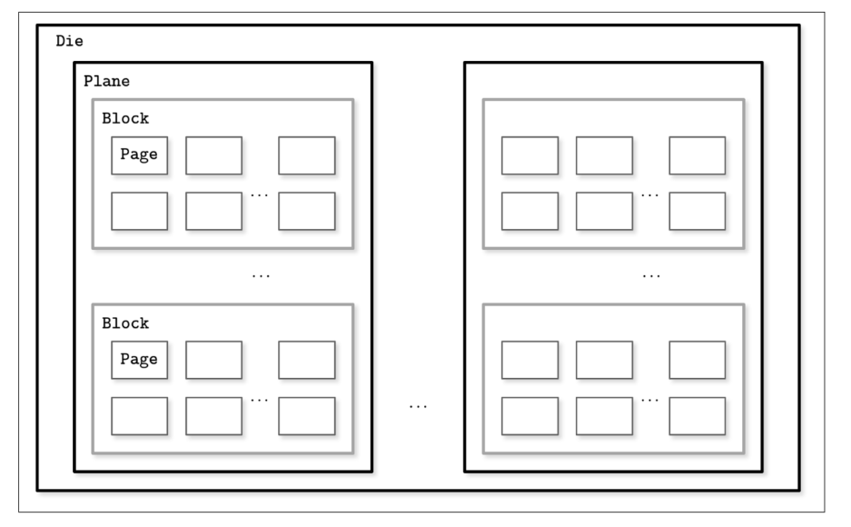

# Disk-based DataStructure 

### quick revision on Binary Trees
i will cover some of the time complexities for the Binary trees which i always forget, the rest of concept should be familier to you.

- h => height of the tree, if balanced usually is log(n) base 2 
- Search => O(h) if balanced, non balanced is O(n)
- Insert/Delete => O(h) if balanced, O(n) if not
- Find Min/Max => O(h) if balanced, O(n) if not
- Travers/Space => O(n)
- Predecessor => the largest value smaller than X
- Successor => the smallest value larger than X
- right rotation => root goes right
- left rotation => root goes left
- how to know tree is un-balanced => |h(left) - h(right)| > 1

### Trees for Disk-Based Storage

binary search trees are usually not the best option due to several main reasons: 

- balancing => using bst would require a lot of time maintaing the tree rather than read and writes
- ordering problem => new inserted records would be random and will violate the concept of locality. which means new nodes will span across several pages.
- low fanout (fanout means the number of childern a node can have) => bst and 2-3 trees has a low fanout which forces us to do O(log(n)) disk seeks at worst scenario. 

Considering these factors, a version of the tree that would be better suited for disk
implementation has to exhibit the following properties:
• High fanout to improve locality of the neighboring keys.
• Low height to reduce the number of seeks during traversal.

> Fanout and height are inversely correlated: the higher the fanout,
the lower the height. If fanout is high, each node can hold more
children, reducing the number of nodes and, subsequently, reduc‐
ing height.

### Solid State Drives
Solid state drives (SSDs) do not have moving parts: there’s no disk that spins, or head
that has to be positioned for the read. A typical SSD is built of memory cells, connec‐
ted into strings (typically 32 to 64 cells per string), strings are combined into arrays,
arrays are combined into pages, and pages are combined into blocks 
Depending on the exact technology used, a cell can hold one or multiple bits of data.
Pages vary in size between devices, but typically their sizes range from 2 to 16 Kb.
Blocks typically contain 64 to 512 pages. Blocks are organized into planes and, finally,
planes are placed on a die. SSDs can have one or more dies. 

cells → strings → arrays → pages → blocks → planes → die

### B-Tree Hierarchy

B-Trees consist of multiple nodes. Each node holds up to N keys and N + 1 pointers
to the child nodes. These nodes are logically grouped into three groups:

Root node
- This has no parents and is the top of the tree.
Leaf nodes
- These are the bottom layer nodes that have no child nodes.
Internal nodes
- These are all other nodes, connecting root with leaves. There is usually more
than one level of internal nodes.

#### binary search tree on B-tree nodes
it is the same binary search tree but we instead return the low key if we didn't find the thing we search for, which we would use that key to go to the next level in the tree.

for ranged queiries, you start with the lower bound and iterate over all keys after it until you reach the upper bound. 

#### insertion summary in case of a node overflow
1. Allocate a new node.
2. Copy half the elements from the splitting node to the new one.
3. Place the new element into the corresponding node.
4. At the parent of the split node, add a separator key and a pointer to the new
node.

#### deletion 

#### tips with this
use a visualizer for this, would be great. 